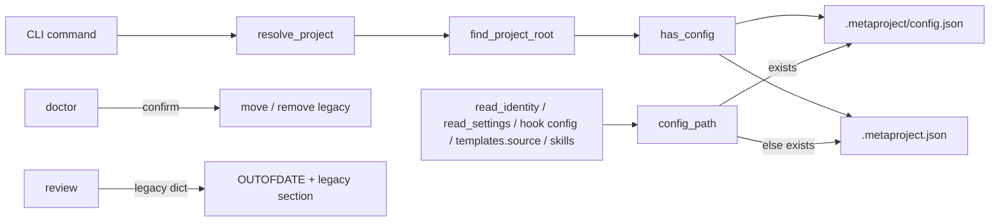

# Move project identity to .metaproject/config.json — Design

**Author**: John Fricker.
**Derived from**: SPEC.md (2026-11-21).
**Last updated**: 2026-11-21.
**Status**: Approved.
**Approved by**: John Fricker (2026-11-21, pre-approved in session).

## Affected components

- **`identity.py`** — owns the path. `IDENTITY_FILE = ".metaproject/config.json"`,
  `LEGACY_IDENTITY_FILE = ".metaproject.json"`. New helpers:
  - `config_path(dir) -> Path` — the resolver (R-CFG-2).
  - `has_config(dir) -> bool` — either regular file exists, with the store guard.
  - `legacy_config(dir) -> Optional[Path]` — the legacy file when it is a regular file.
  - `_is_store_dir(dir)` — `(dir/".metaproject").resolve() == config.get_config_dir()`
    (deferred import, preserving the no-import-cycle note). Applied to the new path only.
  `find_project_root` uses `has_config`; `read_settings`, `read_identity`,
  `write_identity` use `config_path` (write creates `.metaproject/`).
- **Readers** — `hooks.read_hook_config`, `template_source` (`templates.source`),
  `skills.skills_location`/`skills_home`, `catalog.is_managed`, `cli._skills_project`,
  `scaffold` (`new`/`adopt` existence checks) switch from `dir / IDENTITY_FILE` to
  `config_path`/`has_config`. Messages name `IDENTITY_FILE` (the new path).
- **`universe.is_project_root`** — marker list gains `.metaproject/config.json`, keeps
  `.metaproject.json`.
- **`cli.resolve_project`** — prints the R-CFG-6 stderr line when
  `legacy_config(target)` exists and the new file does not.
  `MetaprojectGroup.invoke` prints the R-STORE-2 line once.
- **`config.py`** — `CONFIG_FILENAME = "settings.json"`,
  `LEGACY_CONFIG_FILENAME = "config.json"`; `get_config_file_path` resolves as
  R-STORE-1; `legacy_config_file(dir)` helper; `DEFAULT_CONFIG_FILE` follows.
- **`doctor.py`** — three new checks reusing `_relocate`, `_remove_file`, `_apply`:
  - `check_store_file`/`fix_store_file` (environment, before `config (learn.targets)`);
    `fix_config` receives the path resolved at fix time.
  - `check_project_config`/`fix_project_config` (per managed project, after identity).
  - `check_project_hooks`/`fix_project_hooks` (per managed project): stale iff the
    installed file exists and does not contain the text `.metaproject/config.json`;
    fix copies the bundled script (mode 0755) via `hooks._copy_script`.
  A shared `_pair_state(legacy, new) -> "none"|"legacy"|"current"|"identical"|"differ"`
  compares parsed JSON (falling back to bytes when either is unparseable).
- **`review.py`** — adds `legacy[IDENTITY_FILE] = LEGACY_IDENTITY_FILE` when the legacy
  file exists; identity note text updated. No TUI change: the existing legacy section
  renders it.
- **Hook scripts** — `metaproject_hook.py`: `CONFIG_FILE`, `LEGACY_CONFIG_FILE`, a
  `_config_file(root)` resolver and the store guard (`METAPROJECT_CONFIG_DIR` or
  `~/.metaproject`), used by `_nearest_anchor` and `load_config`.
  `metaproject-session.sh`: the probe loop checks `$probe/.metaproject/config.json`
  (unless `$probe/.metaproject` is the store dir) then `$probe/.metaproject.json`; the
  version reader takes the resolved file name.
- **Text** — README, AGENTS.md, `AGENTS.template.md`, `skill/`, `sdlc_skills/`;
  `make skill-history`; `metaproject skills sync` for this repo.

## Data flow / interfaces

Public names kept: `IDENTITY_FILE` (value changes), `read_identity`, `read_settings`,
`write_identity`, `find_project_root`, `resolve_project_dir`.

## Alternatives considered

- **Skip the store dir only (no rename)** — rejected by the operator in favour of the
  rename; the guard is kept anyway as a transition and custom-dir safety net.
- **Auto-migrate on any write** — rejected: INTENT keeps every move behind doctor.
- **Hash-based hook staleness** — needs a ledger of released script digests; the
  "does it reference the new path" test is exact for this migration and needs none.

## Trade-offs and risks

- Many test fixtures write `.metaproject.json`; they keep working through the fallback,
  but fixtures meant to represent current projects move to the new path, and legacy
  behaviour gets its own tests.
- `IDENTITY_FILE` changing value alters messages that interpolate it — intended.
- `.metaproject/` already contains `docs/`; the doc migration and templates create it,
  so the config write must `mkdir(parents=True, exist_ok=True)` and the scaffold
  tracker records a created directory only when it creates one.
- Stderr warnings could disturb tests that read combined output; they fire only for
  legacy-only fixtures.

## Open questions

None.
