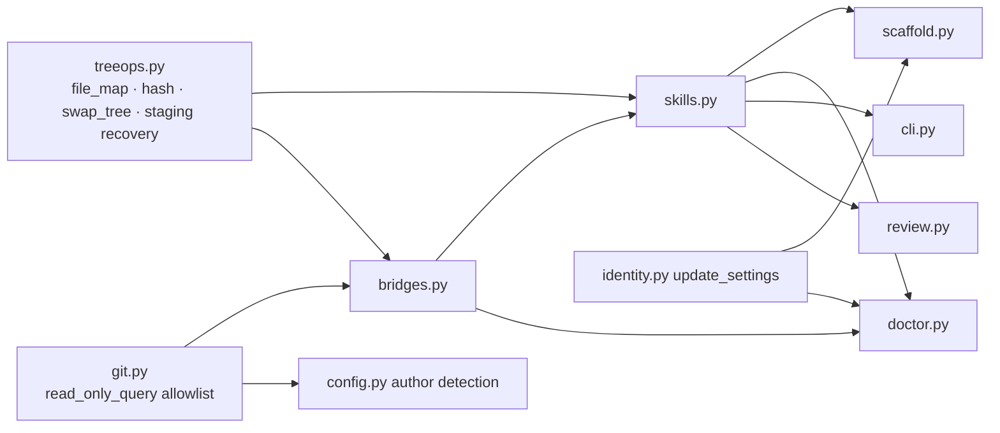
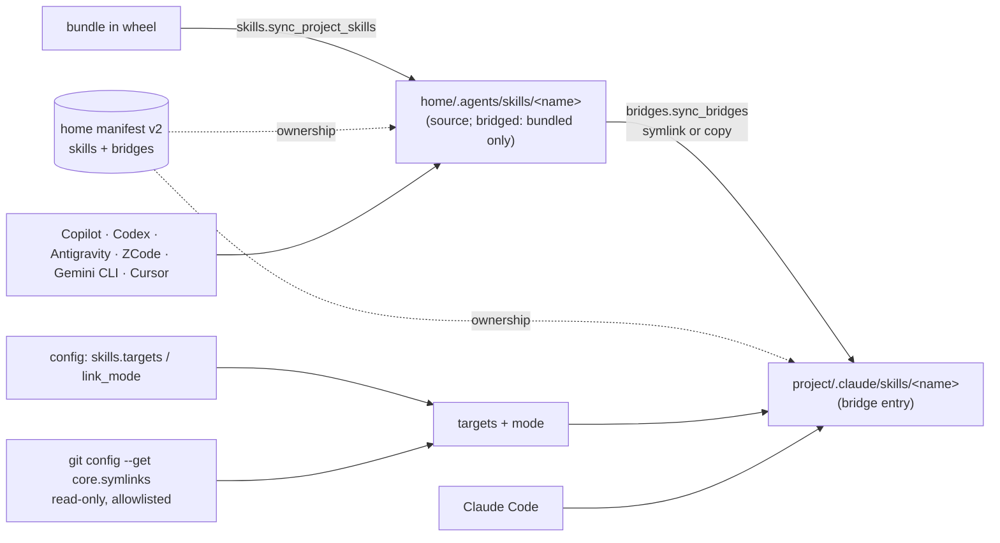

# Harness-neutral project skills: one source, per-harness adapters — Design

**Author**: John Fricker.
**Derived from**: SPEC.md (2026-11-26, v2).
**Last updated**: 2026-11-26.
**Status**: Approved.
**Approved by**: John Fricker (2026-11-26; v2 after the spec review, v1 approved 2026-11-25).

## Affected components

### Module layout (no import cycles)



`skills` imports `bridges`; `bridges` never imports `skills`. Shared filesystem helpers move to
the new `treeops.py`.

### New: `src/metaproject/treeops.py`

Moved from `skills.py` unchanged in behaviour: `hash_content`, `file_map` (symlink/non-regular →
`NON_REGULAR`), `_copy_tree`, `_remove`, `_record_tree`. New `swap_tree(source, dest, expected,
snapshot, staging, key, tracker, warnings)` — the stage → verify → rename aside → rename in →
restore-on-failure method from `skills._replace_skill`, parameterised by `dest` (any directory)
and a staging `key`. Staging lives under `<home>/.agents/.metaproject-skills-tmp/` (existing
`STAGING_NAME`); bridge swaps use `bridges/<project-key>/<name>.{new,old}` plus a
`dest.txt` naming the destination, so `recover_staging` can restore an `.old` to its real
location after a crash (N-3, AC 17). `skills._recover_staging` becomes a call to it.

### New: `src/metaproject/bridges.py` — the only writer under `.claude/skills/<name>`

- `TARGETS = {"claude": TargetSpec(dir=Path(".claude/skills"))}` — data only; a future harness
  is one entry.
- `configured_targets(project_dir) -> (targets, recorded, warnings)` (R-BRG-3/5).
- `_is_windows() -> bool` (the one platform seam, N-4) and `resolve_link_mode(project_dir) ->
  (mode, reason)` (R-BRG-8) using `git.read_only_query(project_dir, "core.symlinks")`; memoised
  per resolved project path for the process.
- Bridged names = `skills.bundled_skills()` names, passed in by the caller (R-BRG-7).
- `lost_user_skills(source_dir, bundled_names)` — non-dot directories with `SKILL.md` in the
  source that are not bundled; used only by the legacy-link finding and the post-migration
  warning (R-BRG-20.1).
- `claude_skills_shape(project_dir, home) -> absent | directory | legacy | foreign_link |
  foreign_file` — legacy covers the resolving symlink and the unmaterialised regular file whose
  stripped content equals the link text (R-BRG-19/21/22).
- `classify_entry(path, source, record, resolved_mode, explicit_mode) -> state` (R-BRG-11/12).
  Decision order: no record → `foreign` if anything exists (with `identical` flag) else
  `missing`; recorded but absent → `missing`; recorded symlink: expected text → `current`,
  other text or dangling → `outdated`; regular file with recorded link text → `outdated`
  (unmaterialised); recorded copy: hashes == source → `current` (then `outdated` only if
  `explicit_mode == "symlink"`), hashes == record ≠ source → `outdated`, else `modified`;
  current symlink with `explicit_mode == "copy"` → `outdated`.
- `BridgeReport` (per target: `mode`, `mode_reason`, `notice`, `entries: {name: (state, action,
  note)}`, `removed`, `warnings`).
- `inspect_bridges(project_dir, home, source_dir, manifest)` and `sync_bridges(..., update, force,
  dry_run, tracker) -> (BridgeReport, updated_bridge_records)`. Pure with respect to the manifest:
  it returns new records; the caller writes the manifest once. Guards in order: newer manifest →
  notice, no writes (R-BRG-16); shape `legacy`/`foreign_*` → notice, no writes (R-BRG-19/21);
  target not configured → removal (R-BRG-14). Symlink write: `os.symlink(relpath)`; on `OSError`
  (not `PermissionError`) fall back to copy with a warning (R-BRG-8). Copy write:
  `treeops.swap_tree`. `PermissionError` on any write → stop the bridge pass, `notice` = write
  denied, keep records of entries already written (R-BRG-15). Tracker records created entries
  and directories for rollback.
- `migrate_legacy_link(project_dir, home, manifest, tracker)` (R-BRG-20.1): snapshot the shape
  (`os.readlink` text, or file bytes) → remove → `mkdir .claude/skills` → `sync_bridges(update=True)`
  → return records with `created: [".claude/skills"]` and the `lost_user_skills` list (computed
  before removal) for doctor to print after success. On any exception: remove the created
  directory tree (only what this call created) and restore the snapshot exactly; re-raise as
  `MetaProjectError` for doctor to report.
- `shadowing(project_dir, names) -> List[str]` — `Path.home()/.claude/skills/<n>` and
  `<project>/.github/skills/<n>` existence (R-BRG-23).

### `src/metaproject/git.py`

- `read_only_query(cwd, key) -> Optional[str]`: runs `git -C <cwd> config --get <key>` only for
  keys in `READ_ONLY_KEYS = {"core.symlinks", "user.name", "user.email"}`, with `timeout=5`,
  `env` adding `GIT_TERMINAL_PROMPT=0`, `capture_output`; any exception or non-zero → `None`
  (R-BRG-25). `get_git_identity` and `config.detect_git_user_name` call it, so the allowlist is
  the single place git is reached from agent-safe commands (`init_repository` and the
  doctor/template git helpers stay outside these commands).

### `src/metaproject/skills.py`

- **`Manifest` dataclass** (`state`, `skills`, `bridges`) returned by `load_manifest`;
  `MANIFEST_VERSION = 2`; v1 → `bridges = {}` and rewritten as v2 on next write; > 2 → `newer`.
  `render_manifest`/`_write_manifest` take a `Manifest` (content-unchanged → no write, as today).
  Shape (R-BRG-10):

  ```json
  {"version": 2,
   "skills": {"wrapup": {"release": "0.12.0", "files": {"SKILL.md": "<sha256>"}}},
   "bridges": {".": {"claude": {"created": [".claude/skills"],
                                 "entries": {"wrapup": {"mode": "symlink",
                                                        "link": "../../.agents/skills/wrapup"},
                                             "shipit": {"mode": "copy",
                                                        "files": {"SKILL.md": "<sha256>"}}}}}}}
  ```
- `project_skills_dir` / `SkillsTarget`: the only remaining refusal is "root with no home". The
  `.claude/skills` checks move to `bridges.claude_skills_shape`.
- `sync_project_skills` / `inspect_project_skills`: source pass (unchanged rules) → bridge pass for
  the acting project → one manifest write. `--force NAME` is passed to both passes (R-BRG-13).
  `SkillsReport` gains `bridges: Dict[str, BridgeReport]` and `shadowing: List[str]`.
- **Transition (for a green gate at every plan step):** step 3 keeps `SkillsTarget.link`,
  `SkillsReport.link`/`notice`, `ensure_skills_link` and `link_target` as thin deprecated
  shims returning `None`; step 6 deletes them once no caller remains.

### `src/metaproject/identity.py`

- `update_settings(project_dir, keys: tuple[str, ...], value) -> Optional[str]` (R-BRG-6): path
  from `config_path` (legacy in place); parse; not a dict / unreadable → return a warning, write
  nothing; set the nested key only if absent; serialise in `write_identity`'s style.

### `src/metaproject/scaffold.py` and `review.py`

- `link_agent_skills` → `prepare_agent_skills`: `.agents/skills/` + `.gitkeep` at the home only;
  never creates `.claude/skills`.
- `scaffold_project`, `adopt_project`, `backfill_missing`: after deliverables, `update_settings(
  ("skills", "targets"), ["claude"])` tracked by the `TransactionalTracker` (config recorded as
  modified/created for rollback), then `install_project_skills` (create-only; bridges included).
- Result objects (R-BRG-30): scaffold result key `skills_link` and `AdoptResult.skills_link`
  → `skills_bridges` (the `BridgeReport`); `BackfillResult.skills_notice`/`skills_link` →
  `skills_bridges`.

### `src/metaproject/doctor.py`

`_PROJECT_CHECKS` gains three entries around the existing skills check, in R-BRG-20 order, each
with its own check/fix callables so each gets its own confirmation:
`("skills legacy link", check_skills_legacy_link, fix_skills_legacy_link)`,
`("skills targets", check_skills_targets, fix_skills_targets)`,
`("project skills", check_project_skills, fix_project_skills)` (extended with bridge findings;
modified/foreign/newer are report-only), `("skill shadowing", check_skill_shadowing, _no_fix)`.
The legacy fix prints "commit `.claude/skills`". Agent sessions: unchanged report-only path.

### `src/metaproject/cli.py`

- `print_skills_report` and the `new`/`backfill`/`adopt` narrations (dry-run text "would create
  agent-skills layout … (-> ../.agents/skills)" replaced) render `skills_bridges`.
- `skills status`: per-target bridge column, mode/reason line, notices; JSON per R-BRG-28 (`link`
  removed; `refusal` only for no-home). Exit codes per R-BRG-29; `sync --all` failure count uses
  the same rule.

### Docs (R-BRG-31/32)

AGENTS.md (architecture §1/§5, Key Files: `bridges.py`, `treeops.py`, revised `skills.py`,
`scaffold.py`, `git.py`; git rule), README (lines describing the link and the R-SKL-5 refusal,
adoption and sync sections), `src/metaproject/skill/SKILL.md`, `references/commands.md`,
`references/documents.md`, `src/metaproject/templates/AGENTS.template.md`; harness matrix in
`references/commands.md`; SessionStart note. `make skill-history` because bundled skill text
changes (every installed `metaproject` skill becomes `outdated`, replaced by `skills sync`).
DESIGN-INVARIANTS superseded notes are added at wrapup with the cycle's invariants.

## Data flow / interfaces



Every write command: resolve home → recover staging → source pass → bridge pass per configured
target (or removal) → one manifest write → report. `--dry-run`/`status` stop before writes.

## Alternatives considered

- **Parse `.git/config` in-process instead of a git query** — rejected by the operator in favour of
  restating the rule (R-BRG-25): worktree `commondir` and `include` handling would reimplement git.
- **Bridge every skill in the source (bundled and user)** — rejected by the operator: the link
  removal is a one-time migration for a small user base; naming the user skills that would
  become invisible to Claude Code (R-BRG-20.1) is enough, and metaproject keeps out of skills
  it does not ship.
- **"Claimable" unrecorded entries** — dropped: contradicts manifest-only ownership; `--force NAME`
  is the explicit way to adopt an entry.
- **Bridge logic inside `skills.py`** — rejected: one writer per directory, and `skills.py` is ~950
  lines. Helpers go to `treeops.py` to avoid a cycle.
- **Staging under `.claude/`** — rejected: user-owned and sandbox-denied for agents; the existing
  `.agents/` staging is reused.
- **A second manifest in `.claude/skills/`**, **marker files in copies**, **Windows junctions / hard
  links**, **migration inside `skills sync`** — rejected for the reasons in v1 (user-owned
  directory, changes skill content, still a takeover / not preserved by git, sync is unattended).
- **Auto-detecting targets** — dropped by the operator: the run's own writes always qualified.

## Trade-offs and risks

- **Mixed-OS repos** stay stable under `auto` (working entries never flip); the cost is that a
  repo touched from Windows may end up with copies that Mac users then keep. Explicit
  `link_mode` is the documented way to standardise.
- **Unmaterialised-symlink detection** compares file content to the recorded link text; a user
  file that happens to contain exactly that text is treated as broken. Negligible.
- **Manifest v2** locks out older CLIs (accepted, R-BRG-32).
- **Restated git rule** widens what the agent-safe commands may run; contained by the allowlist in
  one function and a test that rejects anything else (AC 18).
- **Claude Code parent walk** in a delegating sub-project sees home and sub-project entries; in
  symlink mode they resolve to one target and load once; in copy mode both load (nested one
  prefixed). Tolerated (INTENT Q1).
- **Test churn**: rewrites in `test_scaffold`, `test_nested_projects`, `test_skills`,
  `test_skills_sync`, `test_skills_sync_all`, `test_doctor`, `test_adopt`, `test_e2e`,
  `test_backfill`; new `test_bridges`, `test_treeops`, git allowlist tests.

## Open questions

None.
